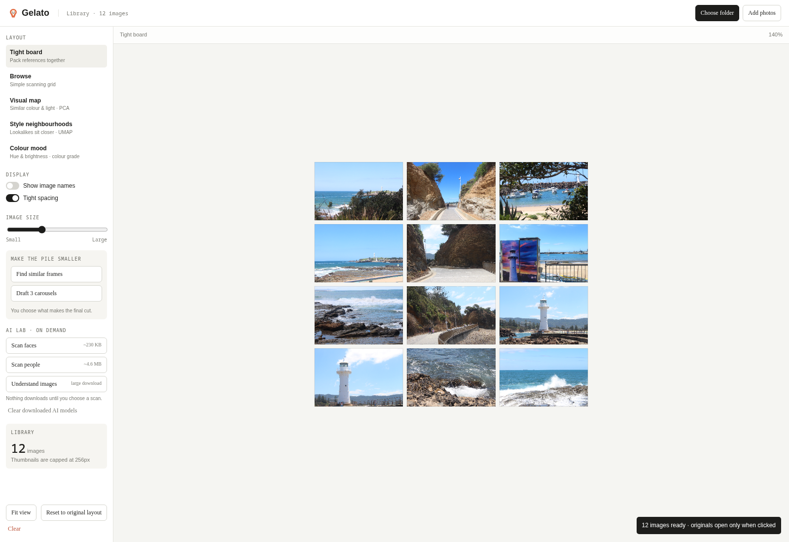

# Gelato

**A lightweight, local-first photo wall for finding and gathering the images you want to keep.**

Gelato turns a folder of photos into a visual wall you can browse, arrange, and curate. It runs in your browser, keeps your source files untouched, and is designed to work offline after the app has loaded.



Start with the folder picker, or try the app with its sample set:


## What you can do

- See a whole photo folder as a wall, grid, visual map, or colour mood board.
- Pull five visually similar images, then select and arrange a group together.
- Review similar frames and draft carousel sequences.
- Copy selected original images into a new folder. Gelato makes copies; it does not move or alter your source files.
- Keep the work on your device. Images are not uploaded by the app.

## Run Gelato

Requirements: Node.js and npm.

```bash
npm install
npm run dev
```

Open the local URL printed by Vite, choose a photo folder, and start arranging. To make a production build:

```bash
npm run build
```

## Privacy and offline use

Photo selection, previews, layout, and curation run locally in your browser. Gelato does not send your images to a server. The app can be used offline after it has loaded, except for optional AI tools: choosing those tools downloads their required models and code, which are cached by the browser. You never need to use the AI tools to browse or arrange photos.

Folder selection and copy-to-folder support depend on browser capabilities. A current Chromium-based browser is recommended for the full folder export workflow.

## Acknowledgements

Gelato adapts parts of its image projection, packing, and selection behavior from [VizThatThing](https://github.com/somerandomguy-coder/VizThatThing), with changes for this project.
