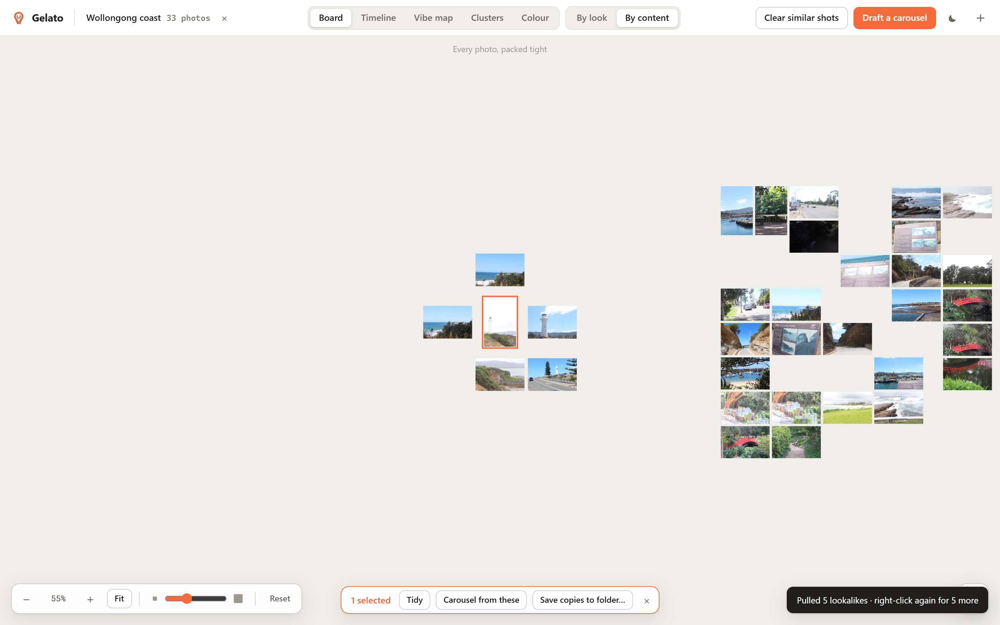
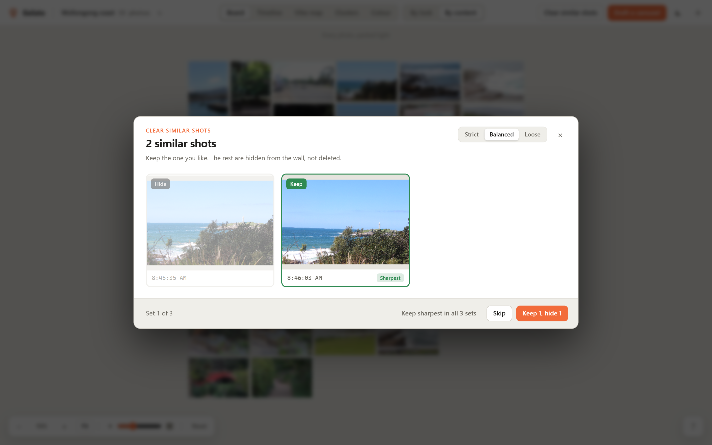
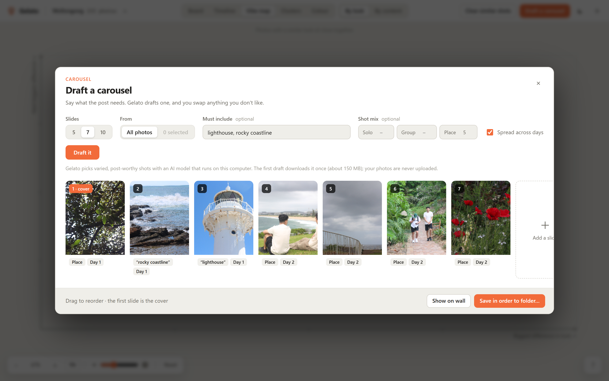
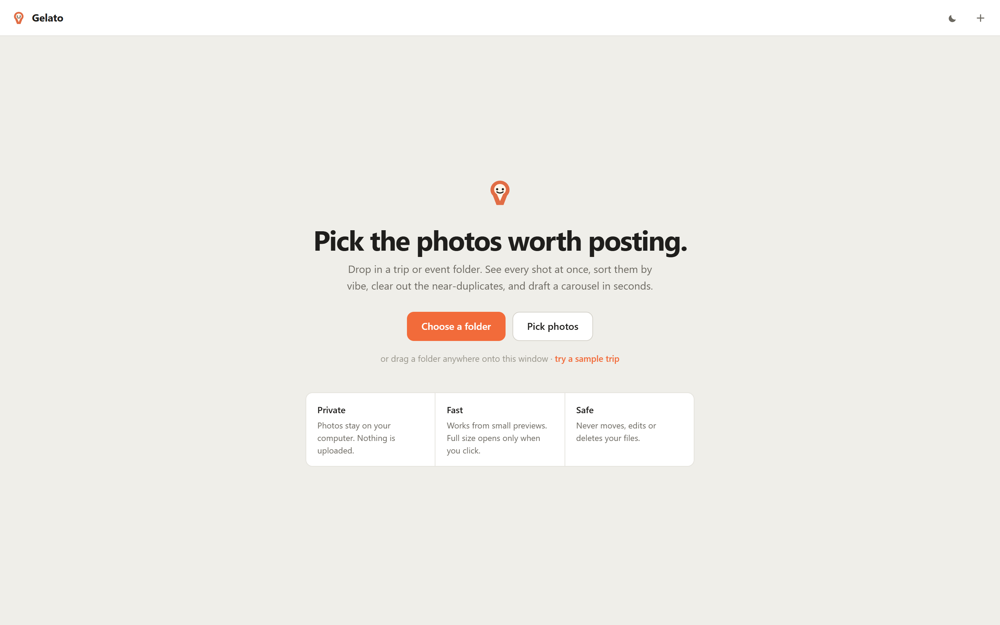

# Gelato

**Pick the photos worth posting.**

Gelato turns a trip or event folder into one visual wall, so you can sort shots by vibe, clear out near-duplicates, and draft a LinkedIn or Instagram carousel in seconds. It runs in your browser, never uploads your photos, and never touches your original files.


Right-click any photo to pull in its five closest lookalikes. Here a lighthouse shot was dragged into empty space and gathered two more lighthouses and three sea views:



Clear out bursts and re-takes. Gelato groups near-identical frames, suggests the sharpest, and hides the rest without deleting anything:



Draft a carousel from the whole folder: name the moments you need and the shot mix, then swap anything you don't like.



Start by choosing or dropping a folder, or try the built-in sample trip:



## What you can do

- **See everything at once.** A pan-and-zoom wall of the whole folder. Drag a folder onto the window to start.
- **Sort by vibe.** Switch between Board, Timeline, Vibe map, Clusters and Colour views, and between **By look** (colour, light, composition) and **By content** (what's in the photo, using an on-device AI model). Adding photos never reshuffles the Vibe map; Clusters can be re-run on demand.
- **Find more like this.** Right-click any photo to pull in its five closest lookalikes, then right-click again for five more.
- **Clear similar shots.** Gelato groups bursts and re-takes, suggests the sharpest frame, and hides the rest (nothing is deleted).
- **Draft a carousel.** Choose 5, 7 or 10 slides and Gelato picks varied, eye-catching shots. Optionally name moments to include ("lighthouse, team dinner", one slide each), an overall feel ("golden hour"), a solo/group/place mix, and spread the picks across days. Swap, remove or reorder any slide, then save the set to a folder in order. The **?** button has a short how-to.

## Run Gelato

Requirements: Node.js and npm.

```bash
npm install
npm run dev
```

Open the local URL printed by Vite, choose a photo folder, and start arranging. To make a production build:

```bash
npm run build
```

## Privacy and offline use

Previews, layout, similar-shot detection and curation run locally in your browser. Gelato does not send your images to a server. Carousel drafting and **By content** sorting use an image-understanding model (CLIP, about 150 MB) that also runs on your computer. It downloads the first time you use either and is then cached by the browser, so it works offline afterwards.

Folder selection and copy-to-folder support depend on browser capabilities. A current Chromium-based browser is recommended for the full folder export workflow.

## Acknowledgements

Gelato adapts parts of its image projection, packing, and selection behavior from [VizThatThing](https://github.com/somerandomguy-coder/VizThatThing), with changes for this project.
